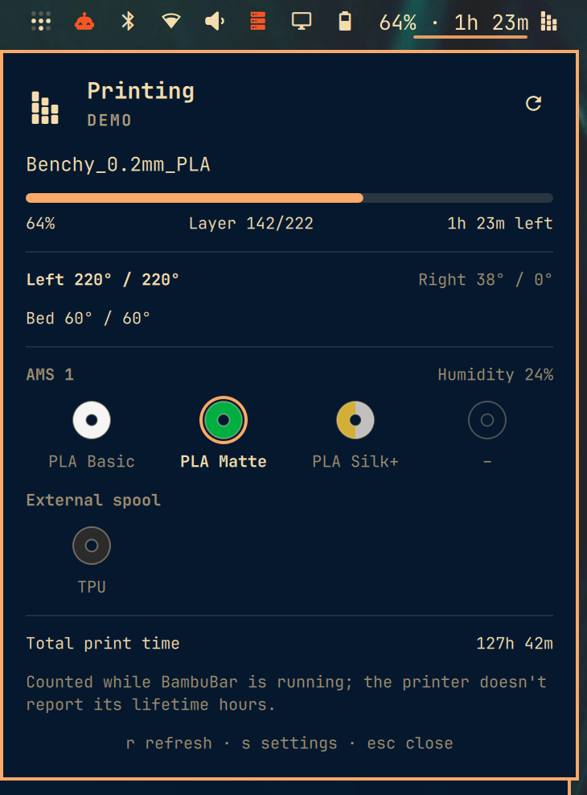

# BambuBar for Omarchy

The live status of your **Bambu Lab** 3D printer in the Omarchy bar: progress, time left, temperatures, the AMS spools in their real colours, and a notification when a print ends, without opening Bambu Studio or the phone app.



*(Demo mode, sample data.)*

This started as the Omarchy version of [BambuBar](https://github.com/kopytjuk/bambubar), a macOS menu bar app, and has grown from there.

- **In the bar:** the bamboo mark, plus progress and time left while a print runs (`64% · 1h 23m`), *Paused*, *Done* or *Failed* otherwise. The mark is dimmed while the printer can't be reached and turns red when a print fails, the login is rejected or the printer's certificate changes.
- **In the panel:** job name, progress bar, layer, time left, nozzle and bed temperature (both nozzles on an H2D or X2D, the printing one highlighted), total print time, and every AMS with its humidity (in % where the hardware reports it, otherwise as a 1–5 level).
- **AMS spools in their colours:** one spool per slot with the filament name, multicolour filament in all its colours, empty slots as an outline, a ring around the spool feeding the nozzle, and the external spool when one is loaded.
- **Notifications** when a print finishes or fails.
- **Local only:** talks directly to the printer on your network. No cloud, no account. The printer's certificate is pinned, so the access code only ever goes to your printer.
- English, Danish and German, following Omarchy's language setting.

## Requirements

- A Bambu Lab printer on the same network, with **LAN mode** on (newer firmware may also need *Developer mode*)
- The printer's **IP address**, **serial number** and **access code**, all on the printer's screen under *Settings → WLAN / Device*
- `python3` and `secret-tool`, both part of a standard Omarchy install

## Install

```bash
omarchy plugin add https://github.com/tripex/omarchy-bambubar --enable
```

Update later with `omarchy plugin update tripex.bambubar`.

## Set up

Click the bamboo icon. The first time, the panel asks for the printer's IP address, serial number and access code. Press **Save** and BambuBar connects, and reconnects on its own if the connection drops.

Change the settings later with the cog in the panel or `s`. Leave the access code empty to keep the saved one.

The first connection checks that the printer's certificate names the serial number you entered and then remembers that certificate (see [Certificate pinning](#certificate-pinning)).

Tip: give the printer a fixed IP address in your router so the setting never goes stale.

## Use

| | |
| --- | --- |
| Click | Open or close the panel |
| Middle-click | Ask the printer for a full status update |
| `r` in the panel | Same as middle-click |
| `s` in the panel | Printer settings |

From a script or a key binding:

```bash
omarchy-shell tripex.bambubar toggle
omarchy-shell tripex.bambubar status    # e.g. "Printing 64% · 1h 23m"
omarchy-shell tripex.bambubar refresh
```

Widget settings, set with `omarchy bar set tripex.bambubar <key> <value>`:

| Key | Default | |
| --- | --- | --- |
| `showProgress` | `true` | Progress and time left next to the icon. Vertical bars always show the icon only. |
| `notify` | `true` | A desktop notification when a print finishes or fails. Only for prints seen running, not one found finished when BambuBar connects. |
| `demo` | `false` | A sample print, no printer needed. |

## How it works

Bambu Lab printers run an MQTT broker on port `8883` (TLS, user `bblp`, password = access code). The widget starts `bin/bambubar-bridge`, a small Python program using only the standard library, that subscribes to `device/<serial>/report`, asks the printer for a full status dump and merges the partial updates it keeps sending. The bridge and the widget talk JSON lines over stdin and stdout.

Where things are kept:

| What | Where |
| --- | --- |
| IP address, serial number, pinned certificate | `~/.config/bambubar/printer.json` |
| Access code | Your keyring (`secret-tool`, service `bambubar`) |
| Total print time | `~/.local/state/bambubar/stats.json` |

The access code goes to the bridge over stdin, never on a command line, so it doesn't show up in `ps`.

### Certificate pinning

The access code is the printer's only credential: anything holding it can drive the printer. And an IP address from DHCP only says who answers there today. So the bridge looks at the printer's certificate before it sends the code:

- The certificate is self-signed by Bambu and names the printer's serial number. On the first connection BambuBar only goes ahead when that name matches the serial you entered, and then saves the certificate's SHA-256 fingerprint.
- Every later connection must show the same certificate. If it doesn't, the code is held back and the panel says the certificate changed, with a button to trust the new one (after a factory reset, say). A certificate naming another serial means another device has the address; the panel says which serial it found.
- Changing only the IP address keeps the pin, so a printer that moved is recognised by its certificate. Changing the serial starts over.

## Limitations

- Works on the local network only (use a VPN or Tailscale to reach your home network from elsewhere).
- The printer does not report its lifetime print hours over MQTT, so *Total print time* only counts what BambuBar has seen while it was running.
- One printer.
- No camera and no printer controls (stop, pause, light): BambuBar only watches.
- Report fields follow [ha-bambulab](https://github.com/greghesp/ha-bambulab), checked against its sample reports from an X2D; other models and firmware may report fields differently. On dual-nozzle printers, nozzle 0 is shown as right and 1 as left, as ha-bambulab does.

## Development

```bash
python3 -m unittest discover -s tests
```

The tests cover the MQTT framing, the report parsing (including a trimmed X2D report), certificate pinning and a full connection against a fake TLS printer (needs `openssl` to make test certificates).

Omarchy runs its shell with Quickshell's file watcher off, so after changing a file run `omarchy restart shell` to see it.

## Disclaimer

BambuBar is an unofficial community project and is not affiliated with or endorsed by Bambu Lab.

## License

[MIT](LICENSE)
